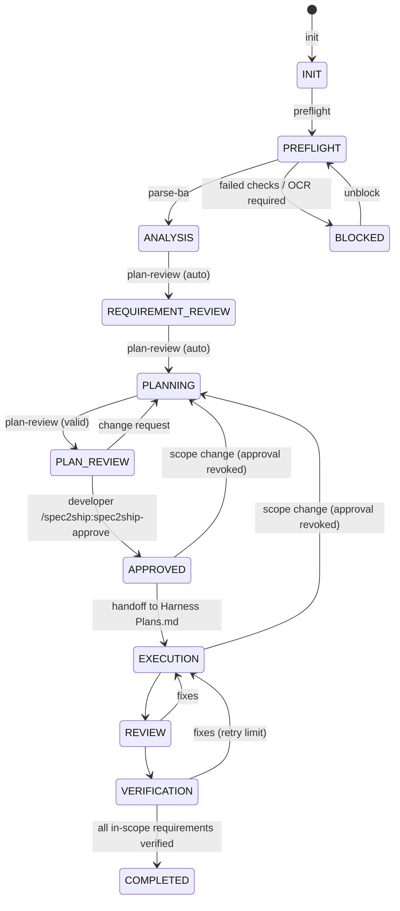

# Workflow

## CLI cheat sheet (`python3 scripts/spec2ship.py ...`)

| Step | Command | Writes |
|---|---|---|
| start | `init --figma URL --ba PATH [--ba PATH] [--instructions T] [--force-new]` | state.json, run.json |
| checks | `preflight`, `figma-check --open-file-name N --node-found yes\|no` or `--error MSG` | state.preflight / figma_check |
| BA | `parse-ba` (exit 3 = OCR required) | analysis/ba-normalized.json |
| repo | `repo-analyze` | analysis/repository-analysis.{json,md} |
| validate | `validate [--stage plan\|approve]` | — |
| review | `plan-review` | planning/spec.md, Plans.md preview, mappings/rtm.json, reports/rtm.md |
| approve | `approve <hash> [--accept-open-questions]` (needs developer intent) | state.approval |
| execute | `handoff` | Harness Plans.md (marked section), backup, task map |
| guard | `guard` (exit 4 = blocked) | — |
| evidence | `record-evidence ...`, `record-check ...` | verification/verification.json |
| report | `report`, `render spec\|plans\|rtm\|all` | reports/report.md |
| misc | `status`, `transition STATE`, `unblock`, `parse-file PATH`, `figma-url URL` | |

## Resume

Every command reloads `state.json` and re-checks prerequisites. `status` reports changed/missing BA inputs (hash
comparison), whether the approval is still current, and Harness Plans.md drift.

## Environment variables

| Variable | Default | Purpose |
|---|---|---|
| `SPEC2SHIP_WORKSPACE` | `.spec2ship` | workspace location |
| `SPEC2SHIP_MAX_RETRIES` | 3 | verification → execution loop limit |
| `SPEC2SHIP_REQUIRE_APPROVAL_INTENT` | 1 | set 0 only in CI/headless automation where no developer types the command |
| `CLAUDE_CONFIG_DIR` | `~/.claude` | where Harness installation is detected |
